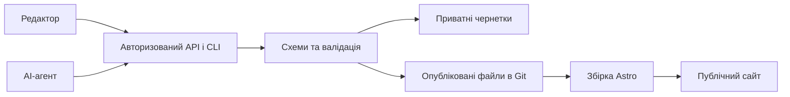

# Архітектура CMS для Astro-сайтів

Статус: узгоджена ціль; поточний код ALM ще не відповідає всім пунктам.

## Призначення

Розробник верстає сайт на Astro за окремим дизайном, визначає компоненти та доступні поля. Агент підключає CMS до цього сайту без переписування ядра. Клієнт редагує тексти, посилання, зображення, SEO, сторінки, статті й портфоліо через адмінку. Публічна частина збирається Astro і віддається як готові сторінки. Формат зберігання не видно клієнту.

## Сховище першої версії

Окрема база даних для сторінок, статей і портфоліо не потрібна. Опублікований контент зберігається окремими файлами в Git-репозиторії, а Astro читає його під час збірки. Для колекцій застосовуємо сумісну з Astro Content Collections структуру. JSON придатний для структурованих полів; довгий текст може бути Markdown/MDX або контрольованим форматом редактора. Остаточний формат довгого тексту обираємо після прототипу редактора.

Приклад цільового поділу: `src/content/settings/site.json`, `src/content/pages/home.json`, окремі файли в `src/content/posts/` та `src/content/projects/`. Конкретні шляхи уточнюються під час реалізації. `public/` містить лише те, що можна показати відвідувачу. Чернетки й секрети туди не потрапляють. Після міграції залишається одне канонічне джерело опублікованого контенту; подвійне ручне ведення `src/data/content.json` та `public/content.json` припиняється.

## Контракт даних

Глобальні налаштування, сторінки, статті, проєкти портфоліо й медіа — окремі типи. Кожен запис має стабільний ID, який не змінюється зі slug. Slug унікальний у відповідному просторі адрес; його зміна має визначену поведінку для старого URL. Запис можна зберегти як чернетку, опублікувати, приховати або архівувати. Видалення й відновлення не мають мовчки ламати зв'язки з медіа.

Для структурованих записів одна версіонована декларація схеми задає типи полів, назви для редактора, обов'язковість, обмеження, допустимі значення та правила посилань. Для простих літералів джерелом є Astro-шаблон, а для компонентів — явно дозволені в коді параметри. Адмінка поєднує ці три режими через згенерований маніфест. Кожна зміна схеми записів, яка впливає на старі дані, супроводжується міграцією. Деталі: [модель контенту](CMS_CONTENT_MODEL.md) і [архітектура надбудови](CMS_CODE_FIRST_ARCHITECTURE.md).

## Чернетки, прев'ю та публікація

Чернетка зберігається на серверному боці й доступна авторизованому редактору з іншого пристрою. `localStorage` може додатково рятувати незавершене введення. Для Git-підходу окреме приватне представлення чернеток і захищене повносторінкове прев'ю перевіряємо на прототипі до міграції. Прев'ю має показувати цілісний набір чернеткових даних і не відкривати їх анонімному відвідувачу.

Публікація проходить перевірку схеми й медіа, перевірку базової ревізії, атомарну зміну канонічного контенту, збірку та перевірку деплою. Відповідь GitHub про коміт означає, що зміну прийнято, але не означає, що сайт уже оновився. При помилці збірки попередній робочий сайт залишається доступним, а редактор бачить помилку. Дві одночасні правки одного запису не можуть тихо перезаписати одна одну: API повертає конфлікт для застарілої ревізії.

Історія містить автора, час, зміни, ревізію та статус деплою. Відкат створює нову публікацію з попередніми даними після перевірки схеми та наявності медіа. Git-історія текстів не замінює резервних копій медіа й налаштувань.

## Повторне використання та агенти

Адмінка й агент користуються однаковими авторизованими операціями: читання, створення, зміна, перевірка, чернетка, прев'ю, публікація, історія та відновлення. Масова зміна контенту агентом проходить ту саму валідацію і перевірку конфліктів. Зміна структури контенту є окремою міграцією коду.

Ядро CMS версіонується окремо від конкретного сайту; стартер показує спосіб підключення. Форма пакування має дозволяти оновлювати CMS на вже запущених сайтах без ручного копіювання файлів. Підхід перевіряємо на ALM і другому Astro-сайті з іншим дизайном.

## Безпека й межі

Секрети залишаються на сервері. Запис потребує авторизації, перевірки прав і даних, обмеження спроб входу та захисту запитів. Доступ до Git має мінімально потрібні права. Медіа перевіряються за вмістом, типом і розміром; завантаження не може перезаписати довільний файл. HTML із редактора не вважається довіреним. Стан безпеки підтверджують перевірки, а не довільна оцінка «9/10».

Файлове сховище не призначене для замовлень, платежів, залишків, персональних даних покупців або бронювань. За появи конкретного магазину чи бронювання ці дані отримають окрему транзакційну систему; контентний шар може залишитися файловим. Міграція контенту в базу, якщо колись знадобиться, буде окремою роботою. Модулі e-commerce й booking не входять у поточний перехід.

Швидкість і витрати вимірюються на конкретному сайті. Статична збірка не гарантує 100/100 PageSpeed, сталого TTFB або нульової вартості комерційного хостингу.
