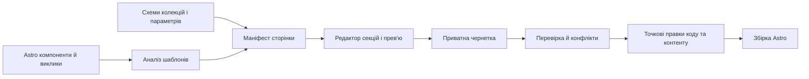

# CMS як надбудова над Astro-сайтом

Статус: архітектурне рішення для наступної реалізації. Воно описує цільову поведінку, а не стверджує, що автоматичний редактор уже працює. Перша перевірка — сайт ALM; повторне використання треба підтвердити на другому Astro-сайті.

## Мета

Дизайн і склад компонентів задає код сайту. Коли розробник додає секцію, звичайний текст, зображення або доступний для редагування параметр компонента, редактор отримує їх з коду без ручного дописування окремої форми для ALM. На сторінці редактор бачить ті самі секції й змінює простий текст подвійним кліком. Зліва показуються поля поточної секції. Адмінка не дає змінювати верстку, CSS або логіку компонента, якщо розробник не відкрив для цього окремий параметр.

## Три джерела редагованих значень

| Режим | Приклад | Канонічне джерело | Звідки беруться поля адмінки |
| --- | --- | --- | --- |
| Літерал у шаблоні | `<h2>Наш підхід</h2>`, `` | `.astro` файл | Аналіз шаблону автоматично знаходить простий текст і статичні атрибути |
| Параметри компонента | `<ButtonComposite text="Зв'язатися" href="/contact">` | Місце виклику компонента в `.astro` | Код компонента явно оголошує **дозволені для CMS** параметри й їхні правила; значення беруться з виклику |
| Структурований контент | стаття, FAQ, список проєктів, багатократні картки | запис Astro Content Collection | Схема колекції визначає поля, валідацію й поведінку списків |

Це різні механізми з одним інтерфейсом. Кнопка є компонентом із редагованими параметрами, навіть якщо її поточні значення записані в коді. Значення, обчислене JavaScript, отримане з API чи передане через складний вираз, не стає автоматично редагованим: редактор показує його як обчислюване і вказує розробнику, де оголосити прив'язку. Вгадувати семантику довільного коду й патчити його небезпечно.

## Схема потоку

Маніфест — похідний результат аналізу коду, не друге ручне джерело полів. Його можна перебудувати після зміни коду. Кожен запис має `siteId`, `pageId`, `sectionId`, `instanceId`, тип, доступні дії, місце походження та початкове значення. Для поля колекції також є шлях до запису й поля. Для літерала — шлях до файлу, структурний шлях вузла, тип вузла та контрольний хеш початкового фрагмента. Позиція в байтах/рядках слугує підказкою, а не єдиною ідентичністю.

## Як адмінка дізнається про секції

1. Аналізує Astro-сторінку й дерево використаних нею компонентів. Секції визначає за семантичним `<section>`, `id` і заголовком; для нетипової розмітки розробник може додати стабільний `cms:key` та назву.
2. Усередині секції знаходить прості текстові вузли, статичні `src`, `alt`, `href` та виклики компонентів. Не показує код у `<script>`, `<style>`, приховані декоративні елементи, SVG-патхи й технічні значення без явного дозволу.
3. Будує ліву панель за порядком секцій на сторінці. Клік по елементу в прев'ю відкриває відповідне поле; вибір секції показує всі її редаговані поля, фото й параметри вкладених компонентів.
4. Після зміни файлу перебудовує маніфест. Новий простий текст з'являється без ручного додавання вкладки або CSS-селектора в адмінку.

Порядок секцій визначає сторінка. Зміна їхнього порядку та додавання секцій через адмінку належать до майбутнього конструктора сторінок.

## Параметри компонентів

Компонент може оголосити метадані на кшталт `text: string`, `href: internal-or-https-url`, `variant: select`, `image: media`. Метадані містять назву для редактора, валідацію, допустимі значення й те, чи дозволена зміна. Публічний `Props` сам по собі недостатній: тип `string` не пояснює, чи це URL, alt-текст, технічний ID або текст кнопки.

Адмінка показує лише дозволені параметри конкретного екземпляра. Для `ButtonComposite` першими є текст і посилання; стиль/варіант додається лише якщо розробник явно його відкрив. Зміна тексту або URL змінює значення в місці виклику, не реалізацію кнопки. Якщо параметр передано з колекції, редагується відповідне поле колекції; якщо значення обчислюване, адміністратор бачить причину недоступності.

## Прев'ю та візуальні стани

- **Синій контур**: простий текст або зображення, взяті з коду. Подвійний клік редагує текст на місці; фото відкриває заміну/alt-текст у панелі.
- **Фіолетовий контур**: екземпляр компонента з оголошеними параметрами. Клік відкриває ці параметри зліва. Для текстового параметра можна залишити пряме редагування, якщо воно не змінює поведінку компонента.
- **Зелений контур**: поле структурованого запису CMS. Панель показує поле й запис; для списків — конкретний елемент за стабільним ID.
- Обчислювані й недоступні елементи не підсвічуються як редаговані. Режими позначені також текстом/іконкою, а не лише кольором.

Метадані елементів вставляються під час збірки редакторського прев'ю, а не добираються за крихкими CSS-селекторами. Публічний сайт не отримує приватну чернетку. Прев'ю використовує реальний Astro-шаблон і накладає чернеткові значення. Панель і прев'ю працюють з однією ревізією чернетки.

## Зміни коду й конфлікти

Для простих літералів **джерелом істини є код**. Зміна тексту в `.astro` одразу змінює значення, яке показує адмінка після оновлення маніфесту. Зміна в адмінці спочатку створює приватну чернетку точкової правки коду. Публікація перевіряє, що вихідний файл і конкретний вузол не змінилися, безпечно переписує тільки відповідний текст/атрибут і створює коміт. Вона не замінює цілий файл старою копією.

Якщо розробник змінив вузол після створення чернетки, редактор показує обидва значення і просить розв'язати конфлікт. При перейменуванні або перестановці вузлів маніфест звіряє стабільний `cms:key` чи структурний шлях разом із контрольним хешем. Якщо однозначного збігу немає, публікація блокується для цього поля. Позиції Astro AST можуть бути неточними, тому перед записом обов'язково перевіряється фактичний фрагмент вихідного файлу.

Для структурованих записів джерело істини — файл запису в `src/content`. Їхні чернетки, ревізії та перевірка схеми проходять наявне ядро CMS. Спільна публікація кількох змін коду, записів і медіа має бути одним атомарним Git-комітом; успішний коміт і успішний деплой — різні стани.

## Безпека й обмеження

Автоматичне виявлення не означає довільного запису у файли. Сервер змінює лише файли всередині дозволеного кореня сайту й тільки розпізнані вузли шаблону; запит не передає довільний шлях для запису. Усі операції потребують авторизації, перевірки ревізії, валідації типу поля і журналу змін. Текст екрану не стає HTML-кодом. Посилання не приймають `javascript:`; завантажені медіа перевіряються окремо.

Автоматичне редагування довільних виразів, умов, циклів, тексту зі скриптів і сторонніх віджетів не є ціллю. Для них розробник оголошує схему або параметр, після чого вони стають доступними у тій самій адмінці. Це чітка межа між безпечним редагуванням контенту й зміною програмної логіки.

## Послідовність реалізації

1. **Маніфест ALM:** аналіз `.astro` файлів, автоматичні секції та прості текстові вузли; тести на зміну коду й повторне виявлення. Перевірити стабільність AST-позицій на реальних компонентах.
2. **Прев'ю без ручних селекторів:** прив'язати маніфест до DOM в редакторському режимі, показати синій контур і автоматичну ліву панель для всіх підтриманих простих текстів.
3. **Чернетки та точковий запис у код:** редагування подвійним кліком, перевірка фрагмента, конфлікти й відновлення. Мігрувати поточний `preview-fields.js` та ALM-вкладки на згенеровані поля; не мати двох систем редагування однієї строки.
4. **Медіа та компонентні параметри:** автоматичне виявлення статичних зображень; кодова декларація дозволених пропсів кнопок, меню й інших компонентів; фіолетовий контур та панель параметрів.
5. **Об'єднання з Content Collections:** зелений стан для структурованих полів, одна чернетка сторінки та спільна атомарна публікація. Перевірити на другому Astro-сайті без ALM-специфічних селекторів чи форм.
6. **Приймання:** редагування коду поза CMS, оновлення маніфесту, конфлікт із чернеткою, невдала збірка, відкат, права, доступність та мобільний екран.

Критерій готовності: розробник додає нову Astro-секцію з простим заголовком, абзацом і фото; після перебудови без правок коду адмінки вони з'являються в правильній секції, редагуються в прев'ю, проходять чернетку й публікацію. Другий сценарій: розробник додає компонент із явно дозволеними параметрами, і його екземпляри отримують власні поля без копіювання ALM-форм.
